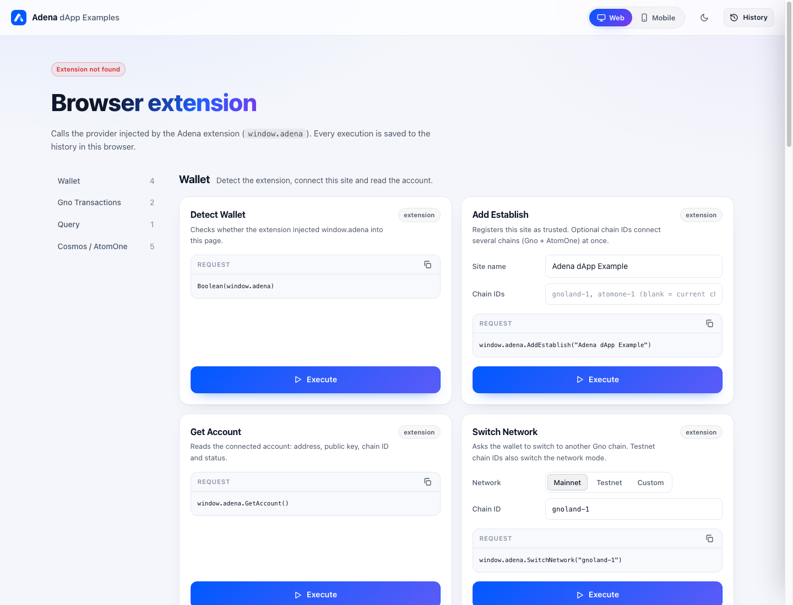
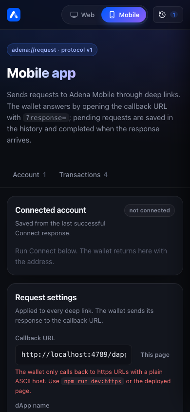

# Adena dApp Examples

Live demo: https://onbloc.github.io/dapp-example

Examples for integrating the Adena wallet from a dApp, on two platforms:

| Route | Platform | Transport |
| --- | --- | --- |
| `/` | Web | Provider injected by the Adena browser extension (`window.adena`) |
| `/mobile` | Mobile | Adena Mobile deep links (`adena://request`) |

Switch between them with the **Web / Mobile** toggle in the header. Every execution (inputs, request, result) is saved to the **History** drawer in `localStorage`, and can be loaded back into its form. The header also switches between the light (default) and dark themes.

<p>
  
  
</p>

## Getting started

```bash
npm install
npm run dev         # http://localhost:5173
npm run dev:https   # https on the LAN, for testing callbacks from a phone
npm test
npm run build       # outputs dist/ (base path /dapp-example/)
npm run deploy      # publishes dist/ to gh-pages
```

## Project structure

```
src/
  app/                 Router, app shell (header, platform switch, history drawer) and theme
  config/              Network presets (Gno, AtomOne)
  core/                Action model, shared field helpers, Gno message builders
  features/
    actions/           Generic action card: renders fields and templates, runs or opens a deep link, records history
    history/           localStorage-backed history store and drawer
    web/               window.adena wrappers, Cosmos sign doc builders, qeval, web actions
    mobile/            Deep link protocol, callback handling, connected session, mobile actions and templates
  lib/                 Storage, base64url, JSON, address and platform helpers
  ui/                  Design system primitives and styles
```

Each example is a declarative `ActionDef` (fields, defaults, optional templates, and either `run` or `build`). Adding an example means adding one object to `features/web/actions` or `features/mobile/actions`.

## Web: extension provider

```ts
await window.adena.AddEstablish('My dApp');
const account = await window.adena.GetAccount();

await window.adena.DoContract({
  messages: [{
    type: '/vm.m_call',
    value: { caller: account.data.address, send: '', pkg_path: 'gno.land/r/demo/counter', func: 'Increment', args: [] },
  }],
  gasFee: 1,
  gasWanted: 3000000,
});
```

The Cosmos / AtomOne examples use the Keplr-compatible `window.adena.cosmos` namespace (`enable`, `getKey`, `signDirect`, `signAmino`, `getOfflineSignerAuto`).

VM Query Eval calls the RPC `vm/qeval` query directly. When the page is served over https, an `http://` RPC is blocked by the browser as mixed content, and the node must allow CORS.

## Mobile: deep link protocol v1

```
Request:  adena://request?payload=<base64url(JSON payload)>
Response: <callback>?response=<base64url(JSON response)>
```

```jsonc
// payload
{
  "version": 1,
  "id": "req-123",                       // echoed back as requestId
  "method": "connect",                   // connect | sign-transaction | sign-and-broadcast
  "callback": "https://example.com/cb",  // https, plain ASCII host
  "dapp": { "name": "My dApp", "url": "https://example.com", "icon": "https://example.com/icon.svg" },
  "chainId": "gnoland-1",                // required for transactions
  "expiresAt": 1767225600000,            // optional, epoch ms
  "params": {                            // transactions only
    "messages": [],                      // 1..16 messages: /bank.MsgSend, /vm.m_call, /vm.m_run, /vm.m_addpkg
    "memo": "",
    "gasWanted": "100000",               // optional; kept only together with gasFee in the fee token
    "gasFee": "100000ugnot"
  }
}

// response
{ "requestId": "req-123", "status": "success", "data": { "address": "g1...", "publicKey": {}, "chainId": "gnoland-1" } }
{ "requestId": "req-123", "status": "failure", "error": { "code": "USER_REJECTED", "message": "User rejected the request" } }
```

- `sign-transaction` returns `{ signedTx, address }`; `sign-and-broadcast` returns `{ hash, height, data? }`.
- Transactions require a prior `connect` from the same callback origin.
- The signer of every message (`caller`, `from_address`, `creator`) must be the wallet's current account.
- The payload is limited to 64 KiB.

How this example uses it:

1. A request is saved to History as `pending` with its `id` before the page navigates to `adena://request`.
2. The wallet opens the callback URL (the `/mobile` page by default). The page decodes `?response=`, completes the matching entry, and removes the parameter from the URL.
3. A successful `connect` response stores the account, which the **Use connected** buttons fill in.
4. A response whose `requestId` was not sent from this browser is kept as *Unmatched* and never updates the session.

On desktop, the **QR** button hands a request to a phone; the response then returns to that phone's browser.

The callback must be `https`. For local testing on a device, run `npm run dev:https` and open the LAN URL on the phone (accept the self-signed certificate), or use the deployed page.

### Templates

**Multi-message Transaction** has a `GnoSwap: GNOT → GNS` template. Given a caller and an amount, it fills three messages for `dev.gnoswap`:

1. `gno.land/r/gnoland/wugnot.Deposit` with the amount as `send`
2. `gno.land/r/gnoland/wugnot.Approve` for the router realm address
3. `gno.land/r/gnoswap/router.ExactInSwapRoute` through the `wugnot:GNS` 0.3% pool, with deadline `9999999999` and a minimum received of `0`

A minimum received of `0` disables slippage protection, so the swap executes at any price. Use it for testing only.

Templates are declared on an action (`ActionDef.templates`); see `src/features/mobile/templates`.
